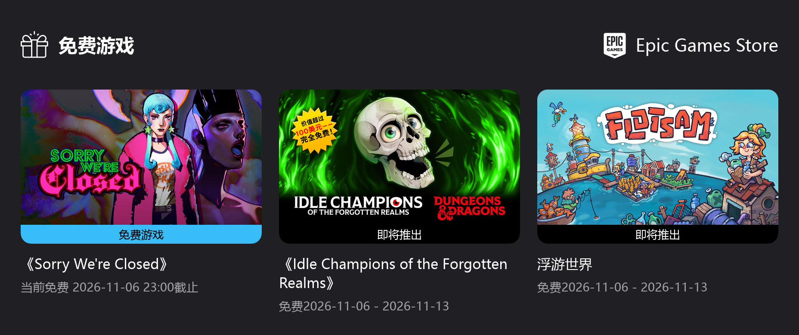

# Epic

插件 id `epic` · 版本 `0.1.5` · Native ABI v6 · windows-x86_64 / linux-x86_64 / macos-aarch64 / android-aarch64 / android-x86_64

## 项目介绍

查询 Epic 商店当前免费与即将免费的游戏，渲染成卡片图，以照片回复命令消息。

- 数据源：Epic 官方促销接口，按 `locale` / `country` 过滤，按配置时区换算日期。
- 工作链路：请求促销接口 → 截断到 `max_cards`（当前免费优先）→ 生成 Vue 模板数据 → 交给宿主 `fuyubot.html2img` 服务出图（JPEG）→ 以照片回复 → 删除临时图。
- 界面在 `assets/card.html`（Vue 模板 + 内联样式）；封面只传公网 `https` URL 由渲染服务拉取，插件不下载、不合成封面，也不链接渲染引擎。
- 稳健降级：没有免费游戏回文本提示；渲染失败自动降级为纯文本清单；接口失败回错误提示。



## 目录结构

源码（`crates/fuyubot-plugin-epic/`）：

```text
plugin.json          # 插件元信息、entry 与 ABI 声明
Cargo.toml           # cdylib + rlib 双目标，lib name = epic
config.default.toml  # 默认配置（最低优先级，会被 [plugin.epic] 覆盖）
README.md
assets/card.html     # 卡片界面：<style> + Vue 模板
examples/render_card_epic.rs
src/
  lib.rs             # 插件入口、启停、inject 声明 html2img 硬依赖
  help.rs            # 向宿主命令表 fuyubot.host.commands 登记 /epic
  cmd/               # 命令解析、任务分发、/epic 业务
  core/              # 配置、HTTP 客户端、Epic 接口解析与数据模型
  host/              # 宿主适配：订阅、消息网关、命令回复、工作线程
  render/            # Vue 数据映射、画布预算、html2img 客户端
```

部署后（原生插件目录，ZIP 根即目录内容）：

```text
plugins/epic/
  plugin.json
  bin/epic.dll       # Linux: libepic.so；macOS: libepic.dylib；Android: libepic.so
```

## 命令一览

| 命令 | 权限/范围 | 作用 |
| --- | --- | --- |
| `/epic` | `user`，私聊 / 群聊 | 查询当前免费与即将免费的游戏，出卡片图 |
| `/epicfree` | `user`，私聊 / 群聊 | 与 `/epic` 完全等价的别名 |

命令前缀只跟随宿主 `[config].PREFIXES`（缺省 `/ ! ！ . #`），本插件不读 `[plugin.epic].prefixes`。

## 配置一览

配置段 `[plugin.epic]`，所有字段可选：

| 字段 | 默认值 | 说明 |
| --- | --- | --- |
| `api_url` | `https://store-site-backend-static.ak.epicgames.com/freeGamesPromotions` | 可换成区域接口或镜像 |
| `locale` | `zh-CN` | 接口语言 |
| `country` | `CN` | 接口国家与 `allowCountries` |
| `timezone_offset_hours` | `8` | 接口 UTC 时间换算成本地日期的偏移 |
| `proxy` | 空（直连） | HTTP 代理，如 `http://127.0.0.1:7890`；空串即直连 |
| `timeout_ms` | `20000` | 单次 HTTP 超时（毫秒），最小 `1000` |
| `scale` | `2.0` | 输出倍率，夹到 `0.5`–`3.0`；超像素上限时还会自动下调 |
| `max_per_row` | `4` | 每行卡片数，夹到 `1`–`8`，同时决定画布宽度 |
| `max_cards` | `8` | 单张图最多展示的游戏数，夹到 `1`–`16` |
| `card_width` | `280` | 卡片宽度（CSS px），夹到 `120`–`800` |
| `cover_height` | `157` | 封面高度（CSS px），夹到 `60`–`600` |
| `caption` | 空 | 图片说明；留空则不带说明 |
| `user_agent` | `Mozilla/5.0 (compatible; fuyubot-epic/0.1)` | 请求 UA |

`config.default.toml` 固化上表默认值，其中 `proxy` 留空即直连、不写入文件。

## 使用说明

**安装**：在插件商店安装；或 `fuyubot plugin install ./epic`；或把发布包解压到 `plugins/epic/` 后重启宿主。宿主需已安装 `fuyubot.html2img`。

**最小配置**：

```toml
[plugin.epic]
locale = "zh-CN"
country = "CN"
timezone_offset_hours = 8
scale = 2.0
max_per_row = 4
max_cards = 8
caption = ""
```

**典型用法**：

- `/epic` 或 `/epicfree`：出一张当前可用游戏卡片图。
- 没有免费游戏时回文本「当前没有 Epic 免费游戏。」
- 卡片渲染失败时回退为纯文本游戏清单；接口失败回「获取Epic免费游戏信息失败。」

**构建与打包**（仓库根目录）：

```bash
cargo build --release -p fuyubot-plugin-epic
python scripts/package.py --plugin epic --platform windows-x86_64
```

**发布**：打 `<id>-v<version>` 形式的 tag 并推送，CI 构建 `plugin.json` 声明的平台。

```bash
git tag epic-v0.1.5 && git push origin epic-v0.1.5
```

## 项目依赖（软/硬）

| 类型 | 服务 / 要求 | 说明 |
| --- | --- | --- |
| 硬依赖 | `fuyubot.html2img` | 出图服务（`render`，`vue: true`）。由 `Plugin::inject` 声明，未安装时插件停在 Pending |
| 软依赖 | 无 | 封面由渲染服务拉取，失败只显示占位块；接口失败降级为文本 |
| 宿主内建 | `fuyubot.host.commands`、`fuyubot.host.command`、simplify `sendMessage` | 宿主自带，不算插件依赖，只用于登记 `/help`、回复命令与主动推送 |
| 宿主要求 | Native ABI v6 | 宿主需支持 ABI v6 与服务调用（`call_service`） |
