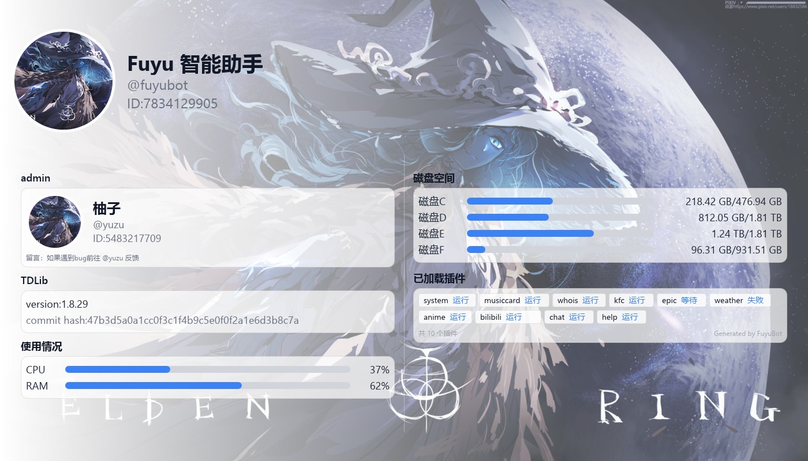

# System

插件 id：`system` ｜ 版本：0.1.5 ｜ ABI：v6 ｜ 平台：windows-x86_64 / linux-x86_64 / macos-aarch64 / android-aarch64 / android-x86_64

## 项目介绍

`/system` 一条命令采集宿主机与机器人状态，渲染成一张 1400×800 的信息卡片并以照片回复：CPU / 内存 / 磁盘由 `sysinfo` 采集，TDLib 版本、机器人资料、管理员资料走宿主的 TDLib 调用，已加载插件清单来自宿主 `list_plugins`。

插件自己不出图：业务数据映射成 `assets/card.html` 里的 Vue 模板数据，交给宿主上的 `fuyubot.html2img` 服务渲染，发送后删除临时产物。外部依赖失败都降级不炸——TDLib 查不到显示「未知」，头像 / 背景缺失自动省略。



## 目录结构

源码 crate：

```text
crates/fuyubot-plugin-system/
├─ plugin.json                 # native / ABI 6 / entry = bin/system.dll
├─ Cargo.toml                  # cdylib（宿主加载）+ rlib（测试 / examples）
├─ config.default.toml         # 最低优先级默认配置（随包发布）
├─ README.md
├─ preview.jpg                 # README 预览图，不打进 bundle
├─ assets/card.html            # 卡片界面：<style> + Vue 模板，编译期嵌入
├─ examples/                   # 生成 html2img 请求 JSON 的样张工具
├─ testdata/                   # 离线回放配置与 updateNewMessage 样例
└─ src/
   ├─ lib.rs                   # Plugin 实现、订阅 updateNewMessage、启停
   ├─ help.rs                  # 把 /system 登记进宿主命令表
   ├─ host/                    # worker.rs、messenger.rs、command.rs、mod.rs
   ├─ cmd/                     # parser.rs（前缀 / @机器人）、system.rs（业务）
   ├─ core/                    # config.rs、sysinfo.rs、td.rs、model.rs
   └─ render/                  # mod.rs、html2img.rs、avatar.rs、samples.rs
```

部署后的 bundle（zip 根就是插件目录内容）：

```text
plugins/system/
├─ plugin.json
├─ config.default.toml
└─ bin/system.dll              # Linux: libsystem.so；macOS: libsystem.dylib
```

## 命令一览

| 命令 | 权限 / 范围 | 作用 |
| --- | --- | --- |
| `/system` | 无权限判断（登记 `role=user`），私聊 / 群聊 | 采集系统信息、TDLib 资料与插件清单，出卡片并回复照片 |

命令名后的参数不会被读取；`/system@机器人名` 这类群聊写法由解析器剥掉 `@` 后缀。命令前缀来自 `[plugin.system].prefixes`，未配置时跟随宿主 `[config].PREFIXES`。

## 配置一览

配置段：`[plugin.system]`，字段全部可选。

| 字段 | 默认值 | 说明 |
| --- | --- | --- |
| `super_admin` | 不配置 | 管理员 user id（正整数）；不配则卡片 admin 一栏显示「未配置」 |
| `background_url` | 内置 B 站图 URL（见 `config.default.toml`） | 卡片背景公网 URL，由 html2img 拉取；写成空串则只用渐变 |
| `timeout_ms` | `5000` | 单次 TDLib 调用超时（毫秒）；兼容旧写法 `timeout`（秒） |
| `avatar_timeout_ms` | `20000` | 头像同步下载预算（毫秒）；兼容旧写法 `avatar_timeout`（秒） |
| `prefixes` | `["/", "!", "！", ".", "#"]` | 命令前缀；不写则跟随宿主 `[config].PREFIXES` |

兼容旧版大写键（`SUPER_ADMIN`、`BACKGROUND_URL`、`TIMEOUT_MS` 等）。

## 使用说明

**安装**

- 插件商店直接安装；或
- 源码目录：`fuyubot plugin install ./system`；或
- 手动解压 zip 到宿主的 `plugins/system/` 后重启宿主。

**最小配置**（`fuyubot.toml`）：

```toml
[plugin.system]
super_admin = 123456789
timeout_ms = 5000
avatar_timeout_ms = 20000
```

`background_url` 写成空串可关掉背景图（纯渐变）；不写 `background_url` 或 `prefixes` 时，分别使用内置背景图与宿主前缀。

**典型用法**

```text
/system                  # 出系统信息卡片
！system                 # 换一个前缀
/system@fengyezzz_bot    # 群聊点名调用
```

**构建与打包**

```bash
cargo build --release -p fuyubot-plugin-system
python scripts/package.py --plugin system --platform windows-x86_64
```

产出 `target/release/system.dll` 与 `system-0.1.5-windows-x86_64.zip`（根为 `plugin.json`、`config.default.toml`、`bin/system.dll`）。

**发布**

```bash
git tag system-v0.1.5
git push origin system-v0.1.5
```

tag 名固定为 `<id>-v<version>`；同一版本已打过 tag 时，先递增 `plugin.json` 的版本号再打新 tag。

## 项目依赖（软/硬）

| 类型 | 服务名 | 说明 |
| --- | --- | --- |
| 硬依赖 | `fuyubot.html2img` | 调 `render` 出图；经 `Plugin::inject` 声明，未安装时插件停在 Pending |
| 软依赖 | `fuyubot.host.commands` | 登记 `/system` 供 `/help` 展示；登记失败只记 warn |
| 宿主内建（不算插件依赖） | `fuyubot.host.command` | 命令回复通道，发新消息 / 编辑原消息 / ephemeral 由宿主决定 |
| 宿主内建（不算插件依赖） | TDLib `invoke`＋`response`、`list_plugins` | 取 TDLib 版本、机器人 / 管理员资料与插件清单 |
| 外部条件 | 公网可达 | `background_url` 由 html2img 拉取，非公网 `http(s)` 时自动丢弃 |

宿主要求：支持 FuyuBot Native **ABI v6**。平台：windows-x86_64 / linux-x86_64 / macos-aarch64 / android-aarch64 / android-x86_64。
