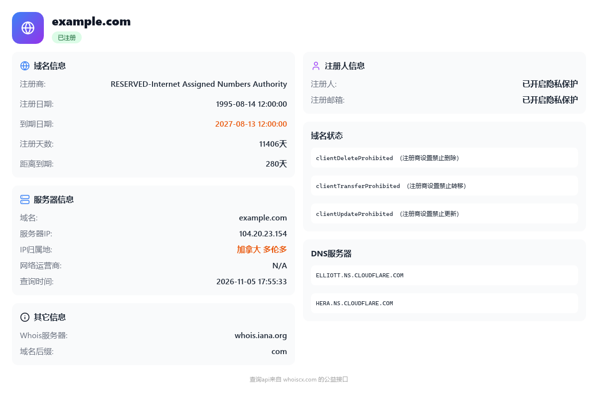

# Whois

插件 id `fengyegf.whois` · 版本 `0.1.6` · Native ABI v6 · windows-x86_64 / linux-x86_64 / macos-aarch64 / android-aarch64 / android-x86_64

## 项目介绍

查询域名 Whois 注册信息与服务器 IP 归属，渲染成信息卡片，以照片回复命令消息。

- 输入宽容：裸域名、完整 URL、带端口 / 路径、中文域名（`例子.中国`）都能解析。
- 卡片内容：域名状态、注册人与注册商、注册 / 到期时间、DNS 服务器、服务器 IP 归属与运营商，左上角优先显示网站自己的图标。
- 工作链路：`/whois <域名>` → 清洗域名 → 请求 Whois 接口 → 查询 IP 归属 → 抓网站图标 → 把卡片数据交给宿主 `fuyubot.html2img` 服务出图（JPEG）→ 以照片回复 → 删除临时图。
- 界面在 `assets/card.html`（Vue 模板 + 内联样式），Rust 只做数据映射，不链接渲染引擎。
- 降级明确：未注册域名回文本；接口报错把原因转给用户；IP 归属与图标失败只少一组数据，不影响出图。



## 目录结构

源码（`crates/fuyubot-plugin-whois/`）：

```text
plugin.json          # 插件元信息、entry 与 ABI 声明
Cargo.toml           # cdylib + rlib 双目标，lib name = whois
config.default.toml  # 默认配置（最低优先级，会被 [plugin.fengyegf.whois] 覆盖）
README.md
assets/card.html     # 卡片界面：<style> + Vue 模板
examples/render_card_whois.rs
src/
  lib.rs             # 插件入口、启停、inject 声明 html2img 硬依赖
  help.rs            # 向宿主命令表 fuyubot.host.commands 登记 /whois
  cmd/               # 命令解析、任务分发、/whois 业务
  core/              # 配置、域名清洗、接口请求、图标、数据模型
  host/              # 宿主适配：订阅、消息网关、命令回复、工作线程
  render/            # Vue 数据映射、图标 data URI、html2img 客户端
```

部署后（原生插件目录，ZIP 根即目录内容）：

```text
plugins/fengyegf.whois/
  plugin.json
  bin/whois.dll      # Linux: libwhois.so；macOS: libwhois.dylib；Android: libwhois.so
```

## 命令一览

| 命令 | 权限/范围 | 作用 |
| --- | --- | --- |
| `/whois <域名>` | `user`，私聊 / 群聊 | 查询域名 Whois 与 IP 归属，渲染信息卡片并以照片回复 |

命令头由宿主 `[command].prefix` 统一识别并归一化成 `/cmd`，插件不再读取自己的 `prefixes`。

## 配置一览

配置段 `[plugin.fengyegf.whois]`，所有字段可选：

| 字段 | 默认值 | 说明 |
| --- | --- | --- |
| `whois_api_url` | `https://whoiscx.com/api/whois/info/` | Whois 查询接口（须以 http/https 开头） |
| `ip_api_url` | `https://whoiscx.com/api/whois/ip/` | IP 归属查询接口 |
| `width` | `1200` | 卡片宽度（px），自动夹到 `900`–`1600` |
| `timeout_ms` | `15000` | 单次查询超时（毫秒）；也接受 `timeout`（秒） |
| `favicon` | `true` | 是否抓取网站图标，关掉后固定用内置图标 |
| `favicon_timeout_ms` | `6000` | 抓图标的整体预算，夹到 `500`–`30000` 毫秒 |


## 使用说明

**安装**：在插件商店安装；或 `fuyubot plugin install ./whois`；或把发布包解压到 `plugins/fengyegf.whois/` 后重启宿主。

**最小配置**：

```toml
[plugin.fengyegf.whois]
whois_api_url = "https://whoiscx.com/api/whois/info/"
ip_api_url = "https://whoiscx.com/api/whois/ip/"
width = 1200
timeout_ms = 15000
favicon = true
favicon_timeout_ms = 6000
```

**典型用法**：

- `/whois example.com`：裸域名。
- `/whois https://www.example.com/path`：自动裁掉协议、`www.`、路径。
- `/whois 例子.中国`：中文域名。
- 不带参数时返回用法提示；接口限流时返回失败提示。

**构建与打包**（仓库根目录）：

```bash
cargo build --release -p fuyubot-plugin-whois
python scripts/package.py --plugin whois --platform windows-x86_64
```

**发布**：打 `<id>-v<version>` 形式的 tag 并推送，CI 构建 `plugin.json` 声明的平台。

```bash
git tag fengyegf.whois-v0.1.6 && git push origin fengyegf.whois-v0.1.6
```

## 项目依赖（软/硬）

| 类型 | 服务 / 要求 | 说明 |
| --- | --- | --- |
| 硬依赖 | `fuyubot.html2img` | 出图服务（`render`，`vue: true`）。由 `Plugin::inject` 声明，未安装时插件停在 Pending |
| 软依赖 | 无 | IP 归属、网站图标都取自查询目标本身，均失败也不阻断出图 |
| 宿主内建 | `fuyubot.host.commands`、`fuyubot.host.command`、simplify `sendMessage` | 宿主自带，不算插件依赖，只用于登记 `/help`、回复命令与主动推送 |
| 宿主要求 | Native ABI v6 | 宿主需支持 ABI v6 与服务调用（`call_service`） |
